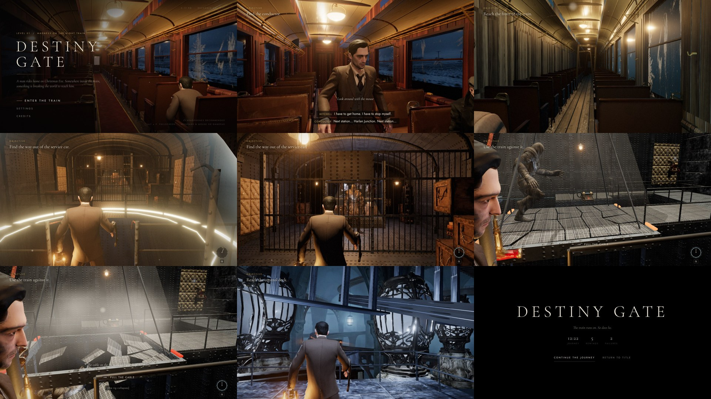

# Destiny Gate — Level 01: Madness on the Night Train

A browser-playable vertical slice. Christmas Eve, 1932: Mitchell Slate's train home slips into the
architecture of his own mind, and something inside it breaks the world as it hunts him.

Third-person psychological horror in five connected spaces — a third-class coach, an aisle that will
not end, a baggage car, a coupling rig and a station that should not exist — built on three systems:

- **The world fractures around Madness.** Tagged floors go stable → stressed → critical → failed as the
  hunter nears. The environment is the threat sensor.
- **The Conductor's Watch** rewinds a small radius of recent physical history, so a failed crossing
  briefly exists again.
- **Cleverness defeats force.** Madness has no health bar. It shares your danger, and the level ends
  when you drop the floor out from under it.



*Captured from the running build with software rendering (no GPU). Real hardware renders the same scenes at full resolution.*

## Play

```bash
npm install
```

```bash
npm run dev
```

Production build (what Netlify serves from `dist/`):

```bash
npm run build
```

| Action | Keyboard / mouse | Gamepad |
|---|---|---|
| Move / look | WASD / mouse | sticks |
| Sprint | Shift | L3 |
| Interact | E | A / Cross |
| Wrench (strike / pull) | Left mouse | RT |
| Focus lantern | Right mouse (hold) | LT |
| Conductor's Watch | Q | RB |
| Objective | Tab (hold) | D-pad up |
| Pause | Esc | Start |
| Fullscreen | Alt + F | — |

Every key can be rebound in Settings → Controls. Accessibility options: subtitles with sound captions,
interactable markers, persistent objective, threat-direction wedge, reduced camera motion, reduced
intensity, brightness, interface size, hold/toggle for lantern and sprint.

## Technology

- **three.js r187 `WebGPURenderer` + TSL**. The shipped default is the **WebGL 2 backend**, which is
  what the automated tests exercise. WebGPU is an opt-in toggle (Settings → Graphics → Renderer, or
  `?webgpu`) and is **not verified** — the build environment has no GPU.
- Fixed 60 Hz simulation with bounded catch-up; rendering interpolates. Rewind history, fracture
  timers, AI and the trap never depend on frame rate.
- Custom deterministic 2.5D collision and grid A\* navigation, both derived from the same authored
  proxies, so collision, AI and fracture state always agree.
- Fixed light budget: six pooled point lights handed to the nearest fixtures, one shadow-casting key,
  one lantern spot. Nothing recompiles mid-chase.
- Post: GTAO (ambient only), bloom, ACES, FXAA, authored grade, grain, vignette.
- Graphics presets (Low / Balanced / High) change fidelity only — never collision, warnings, enemy
  rules or Watch timing — plus adaptive internal resolution.

```
src/core      events, settings, input, fixed-tick loop
src/gfx       renderer + post, calibrated material library, light rig, env probes, VFX
src/world     modelling kit, carriage shell, industrial kit, props, zones (A, B, C, D, station)
src/game      player, camera, collision, fracture + rewind buffer, tools, nav, Madness AI, director
src/audio     buses, crossfaded loops, zone reverbs, music states M0–M5, spatial cues, captions
src/ui        title, content notice, pause, settings, credits, inspect cards, HUD, end card
src/debug     playthrough bot and edge-case suite (loaded only with ?test)
tools         asset pipeline (fal.ai), optimisers, headless QA and capture
```

## Verification

These run headlessly against the dev server (`npm run dev`) or a preview of the build. The container
they were written in has no GPU, so they use software WebGL 2.

Full critical path, played through real input actions by a bot — seat to end card, including a missed
trap pull, escape through the crawl gap, re-arm and the successful collapse:

```bash
node tools/play.mjs
```

GDD 22.3 edge cases (W01–W03, F01, A01–A02, T01–T02, B02–B03) plus checkpoint, fracture-timing and
Watch-tuning checks:

```bash
node tools/edge.mjs
```

Real-time regression with audio on (inspect card, carriage transition):

```bash
node tools/rt_bugs.mjs
```

Hero-shot captures on any preset (GDD 12.5 / 13.6):

```bash
node tools/hero.mjs high
```

**What is and is not verified**

| Area | Status |
|---|---|
| Level completable start to finish | Verified by bot on dev and production builds |
| Edge cases above | 13 / 13 passing |
| No console errors on a clean run | Verified |
| Visual composition per zone and preset | Reviewed from captures (software rendering) |
| Frame rate on real hardware | **Not measured** — no GPU available here |
| WebGPU backend | **Not tested** |
| Firefox / Safari | **Not tested** (Chromium only) |
| Audio mix by ear | **Not possible here** — loudness-normalised by family, levels authored blind |
| Human playtest metrics (GDD 17.3, 22.4) | **Not done** |

Payload: about 38 MB total; roughly 27 MB before first control (budget 35 MB / 90 MB). Around 170–250k
triangles and 60–135 draw calls per pass in gameplay views (budget 350k / 220).

## Assets and rights

Built by **Phatty Acid Generative Studio**. Characters, props, materials, flat art, sound, music and
voice were generated through fal.ai and processed for the browser; see [docs/ASSET_LEDGER.md](docs/ASSET_LEDGER.md) for every prompt and model.
The pipeline is reproducible with `FAL_KEY` set (`tools/fal.mjs`, `tools/build_*.mjs`).

The premise, characters, era and core mechanics come from *Destiny Gate: Design Overview* and
*Concept Overview and Artwork* (© 2009 Paul Limon / Nick Creature). The level layout, puzzle
sequencing and tuning were produced for this slice. **Rights to the title, branding and the 2009
concept art must be confirmed before public distribution.** The story's gravest material is implied,
not depicted; a content notice precedes first play.
